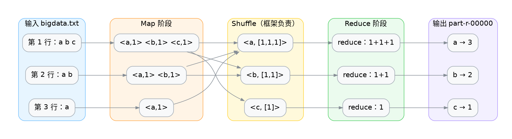
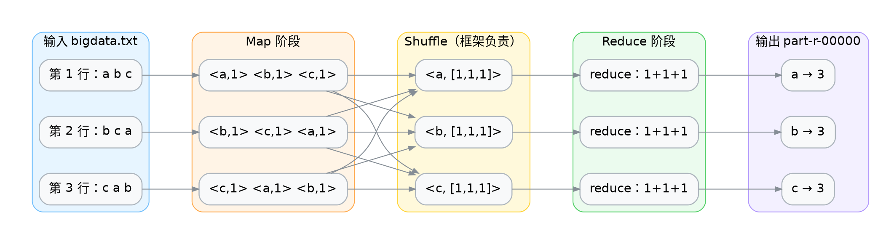

<div class="cover"><h1>词频统计</h1><p>MapReduce 的第一课</p></div>

# 案例概览

本案例统计一段文本里每个单词出现的次数，是 MapReduce 最经典的入门案例。  

## 业务问题

给定任意文本，回答"每个单词出现了几次"。它看起来简单，却是所有"分组 + 累加"类需求的原型——后面绝大多数案例都是把 `<word, 1>` 换成别的 key/value。

## 输入数据与预期输出

输入 `bigdata.txt`，3 行：

```text
a
a b
a b c
```

预期输出 3 行，按单词升序：

| 单词 | 次数 |
| ---- | ---- |
| a    | 3    |
| b    | 2    |
| c    | 1    |

## 前置与后继

| 关系   | 案例     | 承接的知识点        |
| ------ | -------- | ------------------- |
| 本案例 | 词频统计 | 分而治之的基本形态  |
| 后继   | 分组汇总 | 把 `1` 换成真实数值 |
| 后继   | Combiner | 在 map 端预聚合     |

# 理论篇：分而治之怎么落到代码

## 一个思想实验

假设有 1 GB 文本、单机能数但慢。MapReduce 的做法是：把文本切成很多块，每台机器数自己那块里每个词的局部次数，最后把"同词的局部次数"加起来。

| 阶段       | 谁在做          | 产出                          |
| ---------- | --------------- | ----------------------------- |
| 切块并行数 | 多个 map 任务   | 每个词一堆 `<word, 局部次数>` |
| 合并同词   | 框架（Shuffle） | 同词进同一个 reduce           |
| 求和       | reduce 任务     | `<word, 总次数>`              |

关键不在"数"，而在"框架保证同词进同一个 reduce"——你不用自己搬数据。

## map 输出的是 `<单词, 1>` 不是 `<单词, 单词>`

这是初学者最容易绕不过去的弯：value 为什么是常量 `1` 而不是单词本身？

| 写法           | 含义           | 问题                            |
| -------------- | -------------- | ------------------------------- |
| `<word, word>` | 把单词再发一遍 | reduce 端还得自己数个数，没意义 |
| `<word, 1>`    | 发一个计数器   | reduce 把一堆 `1` 加起来即可    |

`1` 是一个"占位计数"。后续案例里这个 `1` 会被换成工资、金额等真实数值，但"map 发计数、reduce 做加法"的结构不变。

# 框架负责排序与分组

map 输出的 `<word, 1>` 不会直接进 reduce。中间经过 Shuffle：框架先按 key 排序，再把相同 key 的 value 收进同一个 `Iterable`。

把输入 `bigdata.txt` 的 3 行进这四个阶段 跑一遍： 



注意中间的交叉线：a 的 `1` 来自 3 个不同的 map 输出，却被收进同一个 `Iterable` —— 这就是"框架保证同 key 进同 reduce"。图中的 3 个 map / reduce 框是**3 次调用**，不是 3 个并行任务（默认 reduce 数仍是 1）。

同一条链路压缩成文字版：

```text
map 输出:  <a,1> <b,1> <c,1> <a,1> <b,1> <a,1>
排序分组后: <a,[1,1,1]> <b,[1,1]> <c,[1]>
reduce 求和: <a,3> <b,2> <c,1>
```

这一步是后面所有案例的共同底座——只要 key 设计对了，聚合交给框架。

# 常规词频统计

先看不用 Hadoop 时，这段逻辑本来长什么样。

## 单机 Java 版

读文件、切词、用 `HashMap` 累加。输入用文件块物化到本章工作目录——`FileReader` 读到的就是这三行：

```text file=bigdata.txt
a
a b
a b c
```

```java
Map<String, Integer> counts = new HashMap<>();

try (BufferedReader reader = new BufferedReader(new FileReader("bigdata.txt"))) {
    String line;
    while ((line = reader.readLine()) != null) {
        for (String word : line.split(" ")) {
            counts.put(word, counts.getOrDefault(word, 0) + 1);
        }
    }
}

counts.forEach((word, count) -> System.out.println(word + "\t" + count));
```

> 直接用 `FileReader` 每次 `read()` 只读一个字符，频繁访问磁盘效率极低。`BufferedReader` 一次性读入一大块数据到内存缓冲区，后续读取直接从内存获取，速度提升非常明显。

## 它其实已经包含 map 和 reduce

| 单机版代码                   | 对应的 MapReduce 阶段 |
| ---------------------------- | --------------------- |
| `line.split(" ")` 后逐词处理 | map：一行切成若干单词 |
| `getOrDefault(word, 0) + 1`  | reduce：同词计数累加  |

区别只在于：单机版没有显式的中间产物 `<word, 1>`，`HashMap` 把"发计数"和"加起来"两步合并成了一次 `put`。

## 它成立的前提

这段代码能跑对，是因为默认了三件事：

| 隐含假设                 | 数据变大后                 |
| ------------------------ | -------------------------- |
| 文件能被一台机器读完     | 1 TB 文本单机装不下        |
| 所有单词的结果放得进内存 | 词典一大，`HashMap` 先撑爆 |
| 只有一台机器在算         | 单机算力有上限，加机器没用 |

三条里任何一条不成立，这段逻辑就失效——而这正是 MapReduce 要解决的问题。

## 从 HashMap 到 Shuffle

| 单机 Java                   | MapReduce                        |
| --------------------------- | -------------------------------- |
| `HashMap` 让同词归到一起    | Shuffle 让同 key 进同一个 reduce |
| `getOrDefault(word, 0) + 1` | reduce 遍历 `Iterable` 累加      |
| 单机顺序读                  | 文件切块，多机各读一块           |
| 结果留在内存                | 中间结果落盘，可跨机器传输       |
| 输出顺序取决于哈希          | 输出按 key 升序                  |

要写的业务逻辑一行没变，变的是"谁负责把同词的数据搬到一起"。下面就用 MapReduce 重写它。

# 实训篇：实现词频统计

本章的 jshell 会话由一个引导块开路：会话建立时自动执行，把 map / reduce 被框架调用那一刻的入参和收集输出的 Context 准备好（幂等，重放时重跑无害）：

```java setup
// 脚手架：模拟"框架调用你"的那一刻——map/reduce 的入参就位，输出收集进 MockContext
import org.apache.hadoop.io.IntWritable;
import org.apache.hadoop.io.LongWritable;
import org.apache.hadoop.io.Text;
import java.util.ArrayList;
import java.util.Arrays;
import java.util.List;

class MockContext {
    List<String> out = new ArrayList<>();
    void write(Text word, IntWritable count) {
        out.add(word + "\t" + count);
    }
}

// map 的世界：当前行 value、行偏移 offset（本案例不使用）、收集输出的 context
Text value = new Text("a b c a b");            // 输入前两行拼在一起，凑出发射流 <a,1>×2
LongWritable offset = new LongWritable(0);
MockContext context = new MockContext();

// reduce 的世界：当前词 key、同词的 value 列表（对应图解里 a 的 <a,[1,1,1]>）
Text key = new Text("a");
Iterable<IntWritable> values = Arrays.asList(new IntWritable(1), new IntWritable(1), new IntWritable(1));
```

## 先搭骨架：继承 Mapper 类

写一个 map 任务不需要从零开始，只要继承框架提供的 `Mapper`，再重写它的 `map` 方法：

```java demo
public class WordCountMapper extends Mapper<LongWritable, Text, Text, IntWritable> {
    @Override
    protected void map(LongWritable key, Text value, Context context) {
        // 只填这里：一行文本怎么变成若干 <key, value>
    }
}
```

分工很清楚：

- **框架负责什么时候调用你、在哪台机器上调用、数据从哪来；**

- **开发者只填中间那一小段转换逻辑。**

 这也是 MapReduce 和自己手写并发程序最大的区别——并行部分完全不在你的代码里：**框架把每个 map / reduce 任务作为一个独立的 JVM 进程，调度到不同机器上执行**。你的类里没有一行进程或线程相关的代码。

尖括号里那四个泛型。它们按固定顺序规定了 map 的入参和出参：`Mapper<LongWritable, Text, Text, IntWritable>`

| 位置    | 泛型实参          | 作用                             |
| ------- | ----------------- | -------------------------------- |
| 第 1 个 | 输入 key 的类型   | `map` 第一个参数的类型           |
| 第 2 个 | 输入 value 的类型 | `map` 第二个参数的类型           |
| 第 3 个 | 输出 key 的类型   | `context.write` 第一个参数的类型 |
| 第 4 个 | 输出 value 的类型 | `context.write` 第二个参数的类型 |

对照整条数据流向就清楚了：

```java demo
map(输入 key, 输入 value, Context)  →  context.write(输出 key, 输出 value)
```

另外，`map` 会被反复调用（每行一次），但这个类是**框架只 new 一次**的——`map` 方法里才是每次调用独立的世界。

## 为什么要自己包装一层类型

回头看刚才那四个位置：为什么不直接填熟悉的 `String`、`int`，而是 `Text`、`IntWritable`、`LongWritable`？

它们都实现了 Hadoop 的 `Writable` 接口。原因是 MapReduce 的 key/value 要跨网络传输、要落盘，因此必须能序列化；而 Java 原生的 `String`、`Integer` 序列化结果冗余过多，所以 Hadoop 专门定义了一套更紧凑的包装类型。

| 类型           | 对应 Java 类型    | 本案例中的角色                                  |
| -------------- | ----------------- | ----------------------------------------------- |
| `Text`         | `String`（UTF-8） | map 输出的单词，也是 reduce 的 key              |
| `IntWritable`  | `int`             | map 发出的计数 `1`，reduce 累加的结果           |
| `LongWritable` | `long`            | map **输入** 的 key：当前行在文件中的字节偏移量 |

用法上只需记住两点：`.get()` 取出包装的原生值（`value.get()` 得到 `int`），构造函数直接传原生值（`new IntWritable(1)`）。

> 顺带解决一个高频疑惑：`Mapper<LongWritable, ...>` 里的第一个 `LongWritable` 是输入行的字节偏移量，**本案例用不到它**——`map` 方法从头到尾没碰过这个 `key`。它既不是行号，也不是单词，只是 TextInputFormat 规定必须带的一个位置标记。

## 步骤一：准备数据

先把输入物化到本章工作目录（随隧道镜像上传到 node0，`hdfs dfs -put` 在远端才找得到它）：

```text file=bigdata.txt
a
a b
a b c
```

```bash
[zhangsan@node0 ~]$ hdfs dfs -mkdir -p /input
[zhangsan@node0 ~]$ hdfs dfs -put bigdata.txt /input/bigdata.txt
```

输入是纯文本，无需表头、无需特殊处理。

## 步骤二：实现 Mapper

每行调用一次 `map`，把行切成单词，每个单词发一个 `<word, 1>`。

```java
String[] wordArray = value.toString().split(" ");

IntWritable one = new IntWritable(1);

for (String word : wordArray) {
    context.write(new Text(word), one);
}
```

## 步骤三：实现 Reducer

遍历同一单词的 value 列表，累加后输出一次。

```java
int count = 0;
for (IntWritable value : values) {
    count += value.get();
}
context.write(key, new IntWritable(count));
```

`context.write` 在循环**外面**——每个单词只输出一行。如果误写进循环，会退化成"逐条原样输出"。

## 步骤四：配置作业

map 输出与最终Reduce输出的 key/value 类型在这里一致，所以两段配置看起来重复；一旦 value 类型变化（比如下一案例换成工资），两者就要分开写。

```java demo
        Configuration conf = new Configuration();
        Job job = Job.getInstance(conf);

        job.setInputFormatClass(TextInputFormat.class);
        job.setOutputFormatClass(TextOutputFormat.class);

        job.setJarByClass(WordCountMain.class);
        job.setMapperClass(WordCountMapper.class);
        job.setReducerClass(WordCountReducer.class);

        job.setMapOutputKeyClass(Text.class);
        job.setMapOutputValueClass(IntWritable.class);

        job.setOutputKeyClass(Text.class);
        job.setOutputValueClass(IntWritable.class);

        FileInputFormat.setInputPaths(job, new Path(args[0]));
        FileOutputFormat.setOutputPath(job, new Path(args[1]));

        job.waitForCompletion(true);
```

## 步骤五：Windows运行调试

这样我们就可以读取本地文件，进行代码调试。


> Windows本地调试时的输入输出路径格式字符串尤其要注意： file:///D:/bigdata

## 步骤六：配置 pom.xml

打包要办两件事：**编译时找得到 Hadoop 的类，运行时找得到程序入口**。

依赖只要一个。`pom.xml` 以文件块物化到本章工作目录（一次给全，含步骤七要配的主类）：

```xml file=pom.xml
<?xml version="1.0" encoding="UTF-8"?>
<project xmlns="http://maven.apache.org/POM/4.0.0"
         xmlns:xsi="http://www.w3.org/2001/XMLSchema-instance"
         xsi:schemaLocation="http://maven.apache.org/POM/4.0.0 http://maven.apache.org/xsd/maven-4.0.0.xsd">
    <modelVersion>4.0.0</modelVersion>

    <groupId>com.studybigdata</groupId>
    <artifactId>hadoop</artifactId>
    <version>1.0-SNAPSHOT</version>
    <packaging>jar</packaging>

    <dependencies>
        <dependency>
            <groupId>org.apache.hadoop</groupId>
            <artifactId>hadoop-client</artifactId>
            <version>3.1.3</version>
        </dependency>
    </dependencies>

    <build>
        <plugins>
            <plugin>
                <groupId>org.apache.maven.plugins</groupId>
                <artifactId>maven-jar-plugin</artifactId>
                <version>2.6</version>
                <configuration>
                    <archive>
                        <manifest>
                            <mainClass>com.studybigdata.hadoop.mapred.awordcount.WordCountMain</mainClass>
                        </manifest>
                    </archive>
                </configuration>
            </plugin>
        </plugins>
    </build>
</project>
```

`hadoop-client` 是聚合依赖，一次性带齐 HDFS、MapReduce、YARN 的客户端类。**版本必须和集群一致**，否则运行时报 `NoSuchMethodError` 这类错。

## 步骤七：指定主类并打包

光打出 jar 还不够——JVM 不知道从哪个类开始执行，运行时会报 `Failed to load Main-Class manifest attribute`。所以要让 `maven-jar-plugin` 把主类写进 `META-INF/MANIFEST.MF`（节选自步骤六的完整 pom）：

```xml
<build>
    <plugins>
        <plugin>
            <groupId>org.apache.maven.plugins</groupId>
            <artifactId>maven-jar-plugin</artifactId>
            <version>2.6</version>
            <configuration>
                <archive>
                    <manifest>
                        <mainClass>com.studybigdata.hadoop.mapred.awordcount.WordCountMain</mainClass>
                    </manifest>
                </configuration>
            </plugin>
        </plugin>
    </plugins>
</build>
```

工程化路径：三个类的全文（与附录一致）以源码树物化进章工作目录，随隧道镜像上传到 node0，`mvn` 在远端章目录里编译：

```java file=src/main/java/com/studybigdata/hadoop/mapred/awordcount/WordCountMapper.java
package com.studybigdata.hadoop.mapred.awordcount;

import org.apache.hadoop.io.IntWritable;
import org.apache.hadoop.io.LongWritable;
import org.apache.hadoop.io.Text;
import org.apache.hadoop.mapreduce.Mapper;

import java.io.IOException;

public class WordCountMapper extends Mapper<LongWritable, Text, Text, IntWritable> {
    @Override
    protected void map(LongWritable key,
                       Text value,
                       Mapper<LongWritable, Text, Text, IntWritable>.Context context) throws IOException, InterruptedException {

        String[] words = value.toString().split(" ");
        for(String word: words){
            context.write(new Text(word), new IntWritable(1));
        }

    }
}
```

```java file=src/main/java/com/studybigdata/hadoop/mapred/awordcount/WordCountReducer.java
package com.studybigdata.hadoop.mapred.awordcount;

import org.apache.hadoop.io.IntWritable;
import org.apache.hadoop.io.Text;
import org.apache.hadoop.mapreduce.Reducer;

import java.io.IOException;

public class WordCountReducer extends Reducer<Text, IntWritable, Text, IntWritable> {

    @Override
    protected void reduce(Text key, Iterable<IntWritable> values, Reducer<Text, IntWritable, Text, IntWritable>.Context context) throws IOException, InterruptedException {

        int sum = 0;
        for(IntWritable value: values){
            sum += value.get();
        }
        context.write(key, new IntWritable(sum));

    }
}
```

```java file=src/main/java/com/studybigdata/hadoop/mapred/awordcount/WordCountMain.java
package com.studybigdata.hadoop.mapred.awordcount;

import org.apache.hadoop.conf.Configuration;
import org.apache.hadoop.fs.Path;
import org.apache.hadoop.io.IntWritable;
import org.apache.hadoop.io.Text;
import org.apache.hadoop.mapreduce.Job;
import org.apache.hadoop.mapreduce.lib.input.FileInputFormat;
import org.apache.hadoop.mapreduce.lib.input.TextInputFormat;
import org.apache.hadoop.mapreduce.lib.output.FileOutputFormat;
import org.apache.hadoop.mapreduce.lib.output.TextOutputFormat;

import java.io.IOException;

public class WordCountMain {
    public static void main(String[] args) throws IOException, InterruptedException, ClassNotFoundException {

        Configuration conf = new Configuration();
        Job job = Job.getInstance(conf);
        job.setInputFormatClass(TextInputFormat.class);
        job.setOutputFormatClass(TextOutputFormat.class);

        job.setJarByClass(WordCountMain.class);
        job.setMapperClass(WordCountMapper.class);
        job.setReducerClass(WordCountReducer.class);

        job.setMapOutputKeyClass(Text.class);
        job.setMapOutputValueClass(IntWritable.class);

        job.setOutputKeyClass(Text.class);
        job.setOutputValueClass(IntWritable.class);

        FileInputFormat.setInputPaths(job, new Path(args[0]));
        FileOutputFormat.setOutputPath(job, new Path(args[1]));

        job.waitForCompletion(true);

    }
}
```

然后打包：

```bash
mvn clean package
```

产物是 `target/hadoop-1.0-SNAPSHOT.jar`。它只包含你自己写的类——Hadoop 的依赖由运行时提供，执行 `hadoop jar` 时框架会自动把它们加进 classpath，所以 jar 里不必打包。

## 步骤八：运行与验证

### 程序运行

配置好 `Main-Class` 后，运行命令可以**省掉类名**（两种写法都有效）：

```bash
hadoop jar target/hadoop-1.0-SNAPSHOT.jar /input/bigdata.txt /output/wordcount
# 等价写法：显式指定主类
# hadoop jar target/hadoop-1.0-SNAPSHOT.jar com.studybigdata.hadoop.mapred.awordcount.WordCountMain /input/bigdata.txt /output/wordcount
```

> 别和步骤四的 `job.setJarByClass(WordCountMain.class)` 搞混：那个告诉框架"把哪个 jar 分发到各节点"，`Main-Class` 告诉 JVM"从哪个类的 `main()` 开始跑"。两者作用不同，都得有。

### 进程状态

```shell demo
(base) [zhangsan@node0 ~]$ jps
53296 ResourceManager
103345 MRAppMaster
103509 YarnChild
52825 DataNode
52698 NameNode
53419 NodeManager
53052 SecondaryNameNode
```

在 Hadoop MapReduce on YARN 中，**MapTask 和 ReduceTask 的 JVM 主类都显示为 `YarnChild`**

### 查看结果

输出 3 行，与上面的预期一致：

```text
a	3
b	2
c	1
```

核对关：行数 = 不同单词数（这里 3）；每行第二个数是该词出现次数。把输入换成更大的文本，结构完全不用改。

# 小结

词频统计把 MapReduce 的核心结构压缩到了最小：map 发 `<key, 1>`，reduce 求和。

## 三句话回顾

- 分布式计数的关键不是"数"，而是"框架保证同 key 进同 reduce"。
- value 是常量 `1` 这样的占位计数，reduce 把它累加成总数。
- 想换统计维度，通常只改 mapper 里的一个分组键，骨架不变。

<div class="end"><h1>词频统计</h1><p>下一内容：Block、Split、MapTask</p></div>

# 附录

以下全文作为阅读材料——带包名的完整类不能进 jshell 片段，工程化执行路径见步骤七的源码树物化。

## WordCount

### WordCountMapper

```java demo
package com.studybigdata.hadoop.mapred.awordcount;

import org.apache.hadoop.io.IntWritable;
import org.apache.hadoop.io.LongWritable;
import org.apache.hadoop.io.Text;
import org.apache.hadoop.mapreduce.Mapper;

import java.io.IOException;

public class WordCountMapper extends Mapper<LongWritable, Text, Text, IntWritable> {
    @Override
    protected void map(LongWritable key,
                       Text value,
                       Mapper<LongWritable, Text, Text, IntWritable>.Context context) throws IOException, InterruptedException {

        String[] words = value.toString().split(" ");
        for(String word: words){
            context.write(new Text(word), new IntWritable(1));
        }

    }
}
```

### WordCountReducer

```java demo
package com.studybigdata.hadoop.mapred.awordcount;

import org.apache.hadoop.io.IntWritable;
import org.apache.hadoop.io.Text;
import org.apache.hadoop.mapreduce.Reducer;

import java.io.IOException;

public class WordCountReducer extends Reducer<Text, IntWritable, Text, IntWritable> {

    @Override
    protected void reduce(Text key, Iterable<IntWritable> values, Reducer<Text, IntWritable, Text, IntWritable>.Context context) throws IOException, InterruptedException {

        int sum = 0;
        for(IntWritable value: values){
            sum += value.get();
        }
        context.write(key, new IntWritable(sum));

    }
}
```

### WordCountMain

```java demo
package com.studybigdata.hadoop.mapred.awordcount;

import org.apache.hadoop.conf.Configuration;
import org.apache.hadoop.fs.Path;
import org.apache.hadoop.io.IntWritable;
import org.apache.hadoop.io.Text;
import org.apache.hadoop.mapreduce.Job;
import org.apache.hadoop.mapreduce.lib.input.FileInputFormat;
import org.apache.hadoop.mapreduce.lib.input.TextInputFormat;
import org.apache.hadoop.mapreduce.lib.output.FileOutputFormat;
import org.apache.hadoop.mapreduce.lib.output.TextOutputFormat;

import java.io.IOException;

public class WordCountMain {
    public static void main(String[] args) throws IOException, InterruptedException, ClassNotFoundException {

        Configuration conf = new Configuration();
        Job job = Job.getInstance(conf);
        job.setInputFormatClass(TextInputFormat.class);
        job.setOutputFormatClass(TextOutputFormat.class);

        job.setJarByClass(WordCountMain.class);
        job.setMapperClass(WordCountMapper.class);
        job.setReducerClass(WordCountReducer.class);

        job.setMapOutputKeyClass(Text.class);
        job.setMapOutputValueClass(IntWritable.class);

        job.setOutputKeyClass(Text.class);
        job.setOutputValueClass(IntWritable.class);

        FileInputFormat.setInputPaths(job, new Path(args[0]));
        FileOutputFormat.setOutputPath(job, new Path(args[1]));

        job.waitForCompletion(true);

    }
}
```


